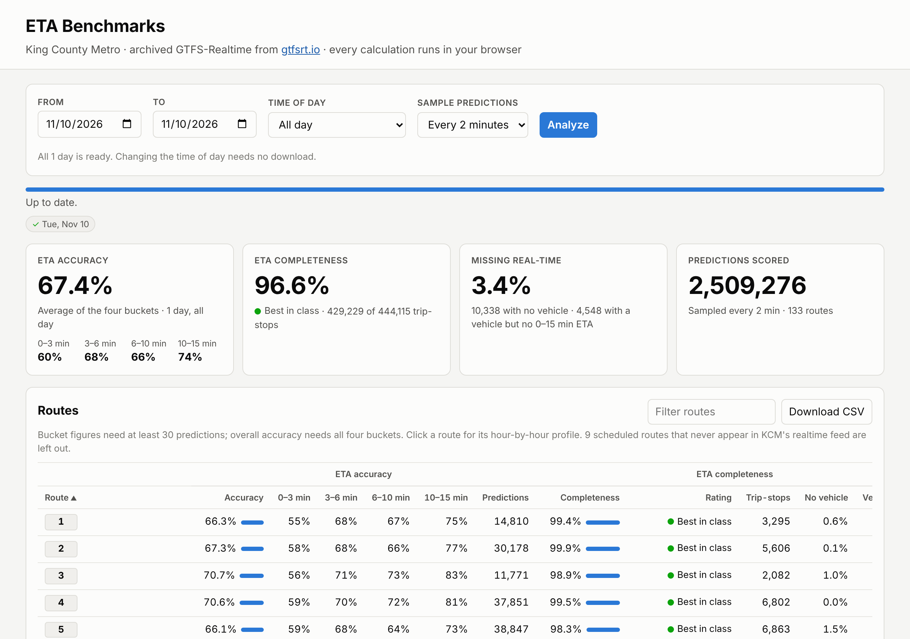

# ETA Benchmarks

Route-level **ETA accuracy** and **ETA completeness** for King County Metro, computed entirely in your browser from the public [gtfsrt.io](https://gtfsrt.io) GTFS-Realtime archive.

- Accuracy follows the [ETA Accuracy Benchmark](https://github.com/TransitApp/ETA-Accuracy-Benchmark): four time buckets with asymmetric windows, and an overall score that is the straight average of the buckets.
- Completeness follows the [ETA Completeness Benchmark](https://github.com/SwiftlyInc/ETA-Completeness-Benchmark): the share of scheduled trip-stops that had a vehicle and a 0–15 minute prediction, or were communicated as `CANCELED` or `SKIPPED`.



The approach is modelled on [Transit Almanac](https://github.com/MisterClean/gtfsrt-dashboard). It is a static site with no server, account or upload. The browser reads Parquet straight from the archive's public bucket with HTTP range requests, and results stay on the device.

## Using it

Pick a date range, a time of day and a sampling rate, then press **Analyze**. Each service day is analysed once and saved in IndexedDB. After that, changing the time-of-day window, or reloading the page, needs no download.

The archive has King County Metro from 2026-09-09. The latest day you can pick is the day before the newest archived UTC file, because evening service runs past midnight UTC.

## Running locally

```bash
npm install
```

```bash
npm run dev
```

```bash
npm run build
```

`npm run build` writes a static site to `dist/` that can be hosted anywhere (GitHub Pages, Netlify, S3). The archive bucket allows cross-origin GET/HEAD.

You can also analyse one day from the command line with the same engine (Node 22.6+):

```bash
npm run analyze-day -- 2026-11-10 120
```

## How it works

```
src/engine/
  archive.ts    archive URLs, request limiter, compact row-group index, row-group reads (hyparquet)
  schedule.ts   choose the schedule version for a day, load and compile routes/trips/stop_times/calendars
  analyze.ts    one service day -> per-route, per-hour rollups of both benchmarks
  metrics.ts    benchmark definitions, rollup layout, summaries, ratings
  cache.ts      IndexedDB (file indexes and finished days)
  worker.ts     Web Worker running the engine
  time.ts       service-day clock in America/Los_Angeles
src/ui/         plain TypeScript interface (no framework)
```

For each service day:

1. **Schedule.** Uses the archived GTFS version in force (the latest one captured by the end of that day), with the trip-stops scheduled for active services.
2. **Actual departures.** Reads every vehicle-positions poll in the day's window. A trip has departed stop *s* when its vehicle is first reported with `current_stop_sequence > s`. The departure time is the midpoint between that report and the one before it, kept only when the two are ≤ 2 minutes apart.
3. **Predictions.** Reads trip-update polls at the chosen sampling rate (default one every 2 minutes, out of one every ~20 s). Each prediction's `departure_time` is compared with the actual departure, bucketed by time from `feed_timestamp` to actual. The same rows mark 0–15 minute predictions, `CANCELED` trips, `SKIPPED` stops and vehicle assignment for completeness.
4. **Rollup.** Results are additive counts by route and service hour (0–29). The UI sums them for any date range and time window, and rates are always computed from summed counts.

### Why these choices

- **Sampling.** Each daily trip-updates file is ~750 MB and 100M+ rows, with one row group per poll. Reading every Nth row group cuts the download proportionally. The accuracy benchmark allows a representative sample. Against every poll for one hour, 2-minute sampling matched within 0.6 points in each bucket.
- **Vehicle positions as ground truth.** KCM drops a stop from its trip updates once it is passed. The last predicted time is not an independent actual. VP-derived departures agree with the final prediction to a median of −12 s at stops passed without a STOPPED_AT report, and −19 s at stops with one.
- **Departure, not arrival.** KCM publishes identical arrival and departure predictions, and the departure is what a waiting rider can miss.
- **Footers.** Each daily file's Parquet footer is 15–25 MB because of the per-poll row groups. It is parsed once and reduced to a small index of poll times and the needed column chunks, which is cached.

### Known limitations

- The first download of a day is roughly 210 MB at 2-minute sampling (about 170 MB for each further consecutive day) and takes about a minute on a good connection. Saved days load instantly.
- "Assigned vehicle" means the trip had a vehicle position, or a `vehicle_id` in its trip update, at any time that day. This follows the completeness benchmark's wording literally.
- Final stops of trips are not scored for accuracy (there is no departure). The first stop is scored on its departure.
- Routes in KCM's schedule bundle that never appear in KCM's realtime feed (some Sound Transit routes run by other operators) are left out and counted in a note.
- Days whose archive files are missing or have gaps longer than 15 minutes are marked partial and are not saved, so they are fetched again next time.
